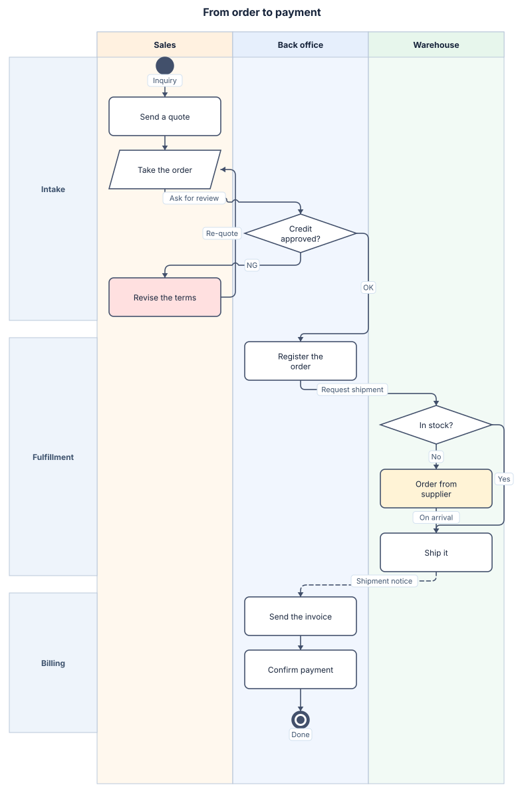

# swimlane-diagram

**English** | [日本語](./README.md)

A library that draws swimlane diagrams (cross-functional flowcharts) as SVG from a few lines of
plain text. **No dependencies, a single file**, and it runs both in the browser and in Node.js.



The diagram above is drawn from this text (`.swim`):

```
swimlane
    title "From order to payment"
    direction TB

    lane sales "Sales" #FFF1E0
    lane back "Back office" #E6EFFC
    lane ware "Warehouse" #E7F6EC

    phase p1 "Intake"
    phase p2 "Fulfillment"
    phase p3 "Billing"

    node s "Inquiry" lane=sales phase=p1 shape=startdot
    node n1 "Send a quote" lane=sales phase=p1
    node n2 "Take the order" lane=sales phase=p1 shape=io
    node d1 "Credit approved?" lane=back phase=p1 shape=decision
    node n3 "Revise the terms" lane=sales phase=p1 color=#FFE0E0
    node n4 "Register the order" lane=back phase=p2
    node d2 "In stock?" lane=ware phase=p2 shape=decision
    node n5 "Order from supplier" lane=ware phase=p2 color=#FFF3D6
    node n6 "Ship it" lane=ware phase=p2
    node n7 "Send the invoice" lane=back phase=p3
    node n8 "Confirm payment" lane=back phase=p3
    node e "Done" lane=back phase=p3 shape=enddot

    s -> n1
    n1 -> n2
    n2 -> d1 "Ask for review"
    d1 -> n4 "OK"
    d1 -> n3 "NG"
    n3 -> n2 "Re-quote"
    n4 -> d2 "Request shipment"
    d2 -> n6 "Yes"
    d2 -> n5 "No"
    n5 -> n6 "On arrival"
    n6 --> n7 "Shipment notice"
    n7 -> n8
    n8 -> e
```

Put a node at the crossing of **who (lane) × when (phase)**, and the position and the route of every
line are worked out for you. You never write coordinates.

The example uses decisions (diamonds), a rework loop, input/output (parallelograms) and a dashed
line (a hand-off or a notice). Where lines cross, one **hops over** the other; where they merge, they
**curve into one**. So you can tell from the shape of a line alone whether it passes by or joins in.

## Getting it

A single `swimlane.js` is all you need. There are three ways to get it.

```
npm install swimlane-diagram
```

```html
<script src="https://cdn.jsdelivr.net/npm/swimlane-diagram@1.2.1/swimlane.js"></script>
```

You can also drop [swimlane.js](swimlane.js) from this repository onto your own server.
**Pin the version** when you load it from a CDN (without `@1.2.1`, your diagram may look different
once the next release lands).

### Browser

```html
<script src="swimlane.js"></script>
<div id="diagram"></div>
<script>
  Swimlane.renderTo('#diagram', `swimlane
    lane a "Applicant"
    node n1 "Submit a request" lane=a
    node n2 "Approve it" lane=a
    n1 -> n2`);
</script>
```

### Node.js

```js
const Swimlane = require('swimlane-diagram');   // './swimlane.js' if you vendored the file

const result = Swimlane.render(code);
if (result.ok) {
  fs.writeFileSync('diagram.svg', result.svg);
} else {
  console.error(result.errors);   // errors carry the line number
}
```

Nothing here touches the DOM, so it works as-is in build scripts and static site generators.

## Writing `.swim`

The first line is `swimlane`. Anything from `#` to the end of a line is a comment.

| Line | Meaning |
|---|---|
| `title "Order flow"` | Title of the diagram (optional) |
| `direction TB` | Flow direction: `TB` (vertical) or `LR` (horizontal). `TB` by default |
| `lane sales "Sales" #FFF1E0` | A lane (who does it). The trailing color is optional |
| `phase p1 "Intake"` | A phase (when it happens). Leave phases out for a lane-only diagram |
| `node n1 "Send a quote" lane=sales phase=p1` | A node. `lane` and `phase` decide where it sits |
| `n1 -> n2 "label"` | A link (solid). The label is optional |
| `n1 --> n2` | A link (dashed) |

Attributes a node can take:

| Attribute | Values |
|---|---|
| `lane=` / `phase=` | Lane id / phase id |
| `shape=` | `process` (default, rectangle) / `start` / `end` (rounded) / `decision` (diamond) / `io` (parallelogram) / `startdot` (●) / `enddot` (◉) |
| `color=` | `#RRGGBB`. Fill color of the node |

Values are read as whitespace-separated tokens, so a value itself cannot contain a space.

## API

```js
Swimlane.render(code)            // → { ok, svg, errors }
Swimlane.renderTo(target, code)  // draws into a selector or element → { ok, svg, errors }
```

When you want finer control:

| Name | What it does |
|---|---|
| `parse(code)` | Parses `.swim` and returns `{ state, errors }` |
| `generate(state)` | Builds `.swim` back from a state (for GUI editors) |
| `computeLayout(state)` | Computes coordinates only; draws nothing |
| `drawSvg(state, layout)` | Produces the SVG string from a computed layout |
| `SHAPES` / `LINK_STYLES` | The available shapes and line styles |
| `VERSION` | Engine version |

Layout (`computeLayout`) and drawing (`drawSvg`) are separate, so you can replace the placement
logic alone and keep the rest.

## About the SVG it produces

- No external CSS and no web fonts. Colors and typefaces are written into the SVG as attributes, so
  it looks the same when loaded with `` or converted to an image.
- A white rectangle sits under the diagram, so the background is never transparent.
- Nothing external is referenced, so a `<canvas>` stays untainted when you turn it into a PNG.

## Related

| | |
|---|---|
| [Swimlane GUI Studio](https://tossie85.site/tools/swimlane-gui-studio.html) | A GUI editor in the browser. Build a diagram from forms and export `.swim` |
| [Swimlane GUI Studio (VS Code)](https://marketplace.visualstudio.com/items?itemName=tossie85.swimlane-gui-studio) | The same tool inside VS Code |
| [Swimlane Diagram Preview (VS Code)](https://marketplace.visualstudio.com/items?itemName=tossie85.swimlane-diagram-preview) | Renders ` ```swimlane ` blocks in the built-in Markdown preview |

## Development

```
npm test
```

39 checks run. They cover which side of a node a line leaves from and enters (out on the right and
bottom, in on the left and top), headers fitting inside their bands, labels never being crossed by
another line, crossings being distinguishable from merges — **properties that decide whether a
diagram can be read at a glance**. The example above (`examples/order.swim` and this English
version) goes through the same checks.

```
npm run example
```

Redraws the README figures (`docs/example.svg` and `docs/example.en.svg`) from `examples/`.
When the example changes, run this instead of editing the SVG by hand. The same diagram also
appears in the two VS Code extensions, where it ships as `docs/example*.png` — the Marketplace
does not accept SVG images.

## License

[MIT](LICENSE)
