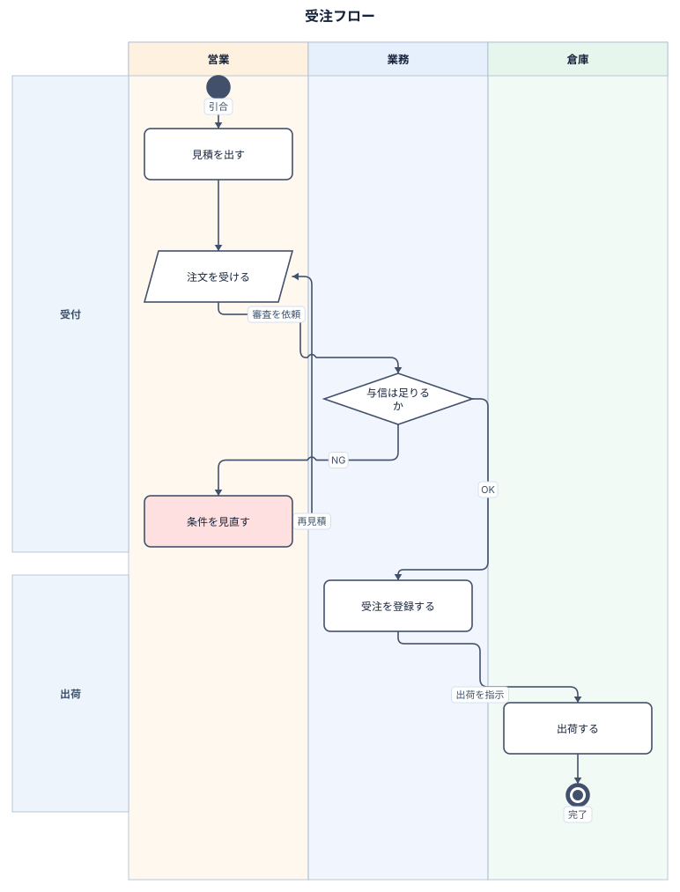

# swimlane-diagram

スイムレーン図（業務フロー図）を、短いテキストから SVG に描くライブラリです。
**依存ライブラリなし・1ファイル**で、ブラウザでも Node.js でも動きます。



この図は、次のテキスト（`.swim`）から描かれています。

```
swimlane
    title "受注フロー"
    direction TB

    lane sales "営業" #FFF1E0
    lane back "業務" #E6EFFC
    lane ware "倉庫" #E7F6EC

    phase p1 "受付"
    phase p2 "出荷"

    node s "引合" lane=sales phase=p1 shape=startdot
    node n1 "見積を出す" lane=sales phase=p1
    node n2 "注文を受ける" lane=sales phase=p1 shape=io
    node d1 "与信は足りるか" lane=back phase=p1 shape=decision
    node n3 "条件を見直す" lane=sales phase=p1 color=#FFE0E0
    node n4 "受注を登録する" lane=back phase=p2
    node n5 "出荷する" lane=ware phase=p2
    node e "完了" lane=ware phase=p2 shape=enddot

    s -> n1
    n1 -> n2
    n2 -> d1 "審査を依頼"
    d1 -> n4 "OK"
    d1 -> n3 "NG"
    n3 -> n2 "再見積"
    n4 -> n5 "出荷を指示"
    n5 -> e
```

**誰が（レーン）× いつ（フェーズ）** の交点にノードを置くと、位置と線の通り道は
自動で決まります。座標を書く必要はありません。

## 使い方

`swimlane.js` を1つ手元に置けば動きます（このリポジトリの
[swimlane.js](swimlane.js) をそのまま使えます）。

### ブラウザ

```html
<script src="swimlane.js"></script>
<div id="diagram"></div>
<script>
  Swimlane.renderTo('#diagram', `swimlane
    lane a "申請者"
    node n1 "申請する" lane=a
    node n2 "承認する" lane=a
    n1 -> n2`);
</script>
```

### Node.js

```js
const Swimlane = require('./swimlane.js');

const result = Swimlane.render(code);
if (result.ok) {
  fs.writeFileSync('diagram.svg', result.svg);
} else {
  console.error(result.errors);   // 行番号つきのエラー
}
```

DOM に依存しないので、ビルドスクリプトや静的サイトの生成でもそのまま使えます。

## `.swim` の書き方

1行目は `swimlane` で始めます。`#` から行末まではコメントです。

| 行 | 意味 |
|---|---|
| `title "受注フロー"` | 図の表題（省略可） |
| `direction TB` | 流れの向き。`TB`（縦）か `LR`（横）。既定は `TB` |
| `lane sales "営業" #FFF1E0` | レーン（担当）。末尾の色は省略可 |
| `phase p1 "受付"` | フェーズ（工程）。省略するとレーンだけの図になる |
| `node n1 "見積を出す" lane=sales phase=p1` | ノード。`lane` と `phase` で置き場所を決める |
| `n1 -> n2 "ラベル"` | 接続（実線）。ラベルは省略可 |
| `n1 --> n2` | 接続（破線） |

ノードに付けられる属性:

| 属性 | 値 |
|---|---|
| `lane=` / `phase=` | レーンID / フェーズID |
| `shape=` | `process`（既定・四角） / `start` / `end`（角丸） / `decision`（ひし形） / `io`（平行四辺形） / `startdot`（●） / `enddot`（◉） |
| `color=` | `#RRGGBB`。ノードの塗り |

## API

```js
Swimlane.render(code)            // → { ok, svg, errors }
Swimlane.renderTo(target, code)  // セレクタか要素に描画して → { ok, svg, errors }
```

細かく扱いたいとき:

| 名前 | 内容 |
|---|---|
| `parse(code)` | `.swim` を解析して `{ state, errors }` を返す |
| `generate(state)` | 状態から `.swim` を組み立てる（GUIエディタ用） |
| `computeLayout(state)` | 座標だけを計算する。描画は含まない |
| `drawSvg(state, layout)` | 計算済みのレイアウトから SVG 文字列を作る |
| `SHAPES` / `LINK_STYLES` | 選べる図形・線種の一覧 |
| `VERSION` | エンジンのバージョン |

レイアウト計算（`computeLayout`）と描画（`drawSvg`）は分かれているので、
配置の仕組みだけ差し替えることもできます。

## 出力されるSVGについて

- 外部CSS・Webフォントに依存しません。色も書体も SVG の属性として書き込まれるので、
  そのまま `` で読んでも、画像に変換しても見た目が変わりません。
- 図の下に白い矩形を敷いてあるため、背景が透明になりません。
- 外部リソースを参照しないので、`<canvas>` 経由で PNG にする際も汚染されません。

## 関連するもの

| | |
|---|---|
| [Swimlane GUI Studio](https://tossie85.site/tools/swimlane-gui-studio.html) | ブラウザで動く GUI エディタ。フォームで組み立てて `.swim` を書き出せる |
| [Swimlane GUI Studio（VS Code 拡張）](https://marketplace.visualstudio.com/items?itemName=tossie85.swimlane-gui-studio) | 同じものを VS Code の中で動かす拡張 |
| [Swimlane Diagram Preview（VS Code 拡張）](https://marketplace.visualstudio.com/items?itemName=tossie85.swimlane-diagram-preview) | Markdown のプレビューで ` ```swimlane ` ブロックを図にする拡張 |

## 開発

```
npm test
```

31件の検証が走ります。線の出入りする辺の使い分け（出力は右・下、入力は左・上）、
見出しが帯からはみ出していないこと、ラベルの上を他の線が通らないこと、
交差と合流が見分けられることなど、**図の読みやすさに直結する性質**を確かめています。

## ライセンス

[MIT](LICENSE)
